# The Night One Client Ate the API

## Rate limiting from 15 lines of JavaScript to Redis, Postgres, and adaptive concurrency

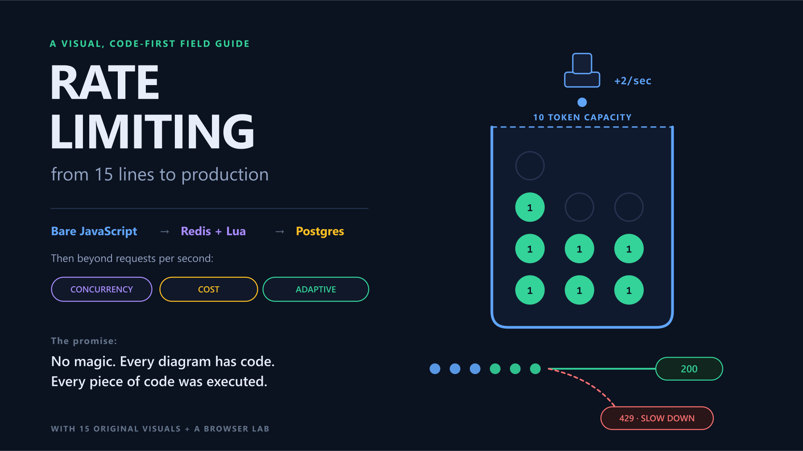

**A visual, code-first field guide for frontend developers, backend developers, freshers, and anyone who has ever stared at a `429` and wondered what the server was actually doing.**

---

## Cold open: 02:13 AM

The API is alive.

Technically.

Health checks return `200`. CPU is at 100%. Database connections are gone. Ordinary users see timeouts. The most confusing graph in the room says traffic is only 8% above normal.

Then somebody groups requests by customer.

One integration is sending the same request hundreds of times a second. Its first call timed out, so it retried. The retry timed out, so it retried again. Ten workers are now helping one broken loop ask the same question faster.

The incident commander asks a wonderfully simple question:

> “Why can one customer spend everybody else's capacity?”

That is the question rate limiting answers.

Not “how do I return a 429?”

Not “which npm package should I install?”

The real question is: **when demand is larger than supply, who gets served, who waits, and who gets told no?**

This article builds that answer four times:

1. with bare JavaScript—no Redis, no database, no package;
2. with Redis—one shared decision across many Node processes;
3. with Redis plus Postgres—fast operational quotas and durable, idempotent settlement;
4. beyond requests per second—concurrency, weighted cost, adaptive limits, and load shedding.

Every diagram here is original. The core teaching paths in the companion files were executed against deterministic tests; the package clearly separates those demonstrations from the additional integration and fault tests a production system still needs. Where we visit Stripe, Cloudflare, Shopify, GitHub, AWS, Google, Redis, OpenAI, and Netflix, the links go to their own engineering material or documentation.

> **Interactive companion:** open [`rate-limiting-playground.html`](rate-limiting-playground.html) directly in a browser. Send traffic, switch algorithms, break a window boundary, solve architecture scenarios, and take the quiz. It has no dependencies and needs no server.

---

# The cast

Before the first act, meet the five characters. Most rate-limiting confusion comes from asking one character to perform another character's job.

### The caller

A user, API key, tenant, device, IP address, service account, or model deployment. The limiter needs a key that represents whichever identity receives the budget.

### The limiter

The decision function:

```txt
(identity, action, cost, time, state) → allow | reject | wait
```

### The state

A counter, a list of timestamps, a token balance, or one virtual timestamp. In Act I it lives in a JavaScript `Map`. In Act II it moves to Redis.

### The protected resource

CPU, workers, database connections, a third-party API, LLM tokens, money, or simple fairness between customers.

### The policy

“100 requests per minute” is only one kind. A real policy might be:

```txt
Free user:       2 requests/sec, burst 10, 10,000 units/month
Pro user:       20 requests/sec, burst 100, 1,000,000 units/month
PDF export:      3 requests in flight per customer
Critical write: reserved capacity, never shed before analytics reads
```

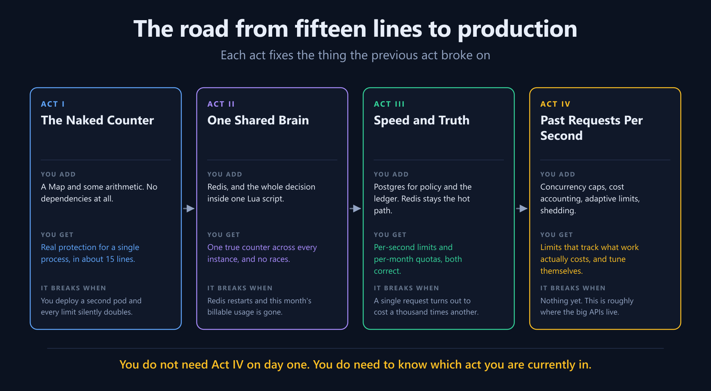

The rule for this journey is simple: **do not add the next dependency until you can name the failure it fixes.**

---

# Act I — The Naked Counter

## Scene 1: the nightclub door

Imagine a club that admits 100 people per minute.

A bouncer stands at the door with a clicker. Clicks 1 to 100 enter. Click 101 waits outside.

That gives us the beginner definition:

> A rate limiter caps how often an identity may perform an action during a period.

But the analogy gets more useful when we ask what the bouncer is protecting.

- **Safety:** the room physically holds 100 people.
- **Fairness:** one bus party should not fill every seat.
- **Cost:** perhaps every admitted guest costs the host money.
- **Abuse:** perhaps one guest keeps leaving and re-entering to disrupt the door.

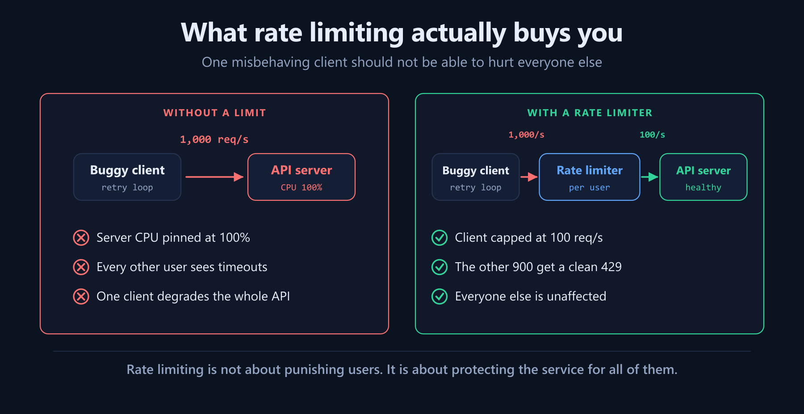

That is why rate limiting exists in production. Stripe describes the same classes of failure: one customer's traffic spike, a broken script, low-priority traffic crowding out critical calls, or a system already in trouble that must preserve its most important work ([Stripe Engineering](https://stripe.com/blog/rate-limiters)).

## Scene 2: five words we will keep separate

Industry vocabulary overlaps—“throttle,” for example, sometimes means delay and sometimes rejection. In this guide, each term names a different **dimension, scope, or action** so the architecture stays clear.

| Term | The question it answers | Typical response |
|---|---|---|
| **Rate limit** | Has this caller done too much in a time interval? | Reject with `429` |
| **Quota** | Has this caller consumed its daily/monthly allocation? | Reject, bill overage, or ask for an upgrade |
| **Throttle** | Can I slow or queue this work instead of rejecting it? | Delay or process at a fixed pace |
| **Concurrency limit** | How much work from this caller is alive right now? | Reject or queue until a slot opens |
| **Load shedder** | Is the whole system in danger regardless of caller? | Drop low-priority work, often with `503` |

A customer can be below its request rate but above its monthly quota. A service can be below both and still collapse because 20 slow requests hold 20 database connections. During an incident, a perfectly polite caller may still be shed because the whole fleet is sick.

One counter cannot answer all of those questions.

---

## Scene 3: fixed window—the twelve-line hero

The first implementation needs one `Map` and no package. The excerpt focuses on the algorithm; the companion file validates positive, finite configuration before creating state:

```js
function createFixedWindow({ limit = 100, windowMs = 60_000 } = {}) {
  const state = new Map(); // key -> { window, count }

  return function check(key, now = Date.now()) {
    const window = Math.floor(now / windowMs);
    const entry = state.get(key);

    if (!entry || entry.window !== window) {
      state.set(key, { window, count: 1 });
      return { allowed: true, remaining: limit - 1 };
    }

    entry.count += 1;
    return {
      allowed: entry.count <= limit,
      remaining: Math.max(0, limit - entry.count),
    };
  };
}
```

The key idea is this line:

```js
Math.floor(now / windowMs)
```

It turns time into numbered boxes. Every timestamp between 12:00:00 and 12:00:59 belongs to one box. At 12:01:00, the box number changes and the counter starts over.

### Pause and predict

The limit is 100 per minute.

- The caller sends 100 requests at `12:00:59`.
- The caller sends 100 more at `12:01:00`.

How many pass?

<details>
<summary>Reveal the answer</summary>

All 200. Each set belongs to a different valid window. The server absorbs roughly twice its intended limit in about one second.

</details>

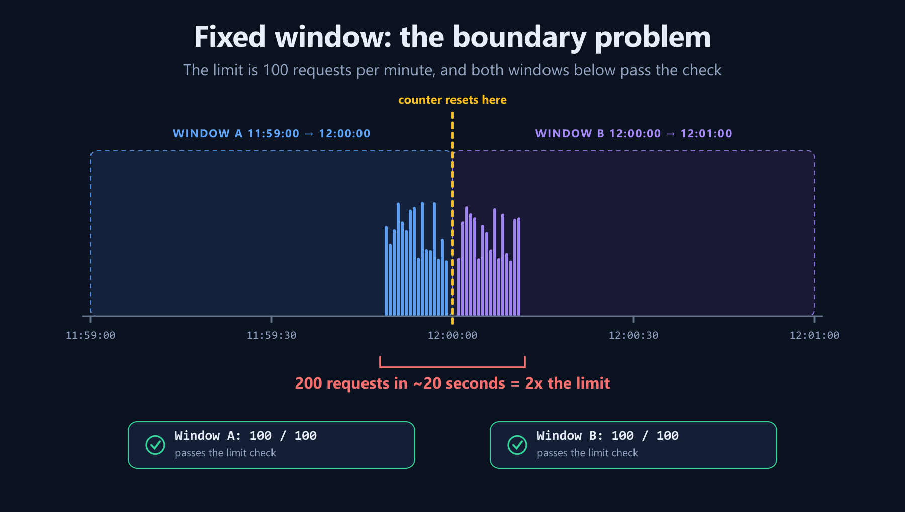

Fixed window is not “bad.” It is cheap, understandable, and often good enough for coarse abuse protection. The lesson is to know its burst shape. Never set a fixed-window limit equal to the absolute traffic your dependency can survive, because the boundary can deliver twice that.

---

## Scene 4: sliding window—the camera starts moving

A true sliding-window log stores one timestamp per accepted request:

```js
function createSlidingWindowLog({ limit = 100, windowMs = 60_000 } = {}) {
  const state = new Map();

  return function check(key, now = Date.now()) {
    const cutoff = now - windowMs;
    const log = (state.get(key) ?? []).filter(t => t > cutoff);

    if (log.length >= limit) {
      state.set(key, log);
      return { allowed: false, retryAfterMs: log[0] - cutoff };
    }

    log.push(now);
    state.set(key, log);
    return { allowed: true, remaining: limit - log.length };
  };
}
```

There is no clock edge to exploit. At 12:01:00, the limiter still sees requests from 12:00:59 because they are inside the trailing minute.

The trade-off is written directly into the data structure: one timestamp per request. A limit of 100 means at most 100 entries per key. A limit of one million means… you should probably not put one million timestamps per key in memory.

### Cloudflare's two-integer trick

Cloudflare published a practical approximation while describing rate limiting across millions of domains: keep the current window count and the previous window count, then weight the previous count by how much of it still overlaps the trailing interval ([Cloudflare Engineering](https://blog.cloudflare.com/counting-things-a-lot-of-different-things)).

```txt
estimated count =
    previous count × (1 - fraction through current window)
  + current count
```

At 25% into a new minute, 75% of the previous minute still overlaps. If the previous count was 100 and the current count is 10, the estimate is 85.

You traded exactness for constant memory: two counts instead of a timestamp list.

---

## Scene 5: token bucket—the default with a memory of silence

Now replace the clicker with a bucket.

- It holds at most 10 tokens.
- It receives 2 new tokens every second.
- A request spends one token.
- No token means no service.

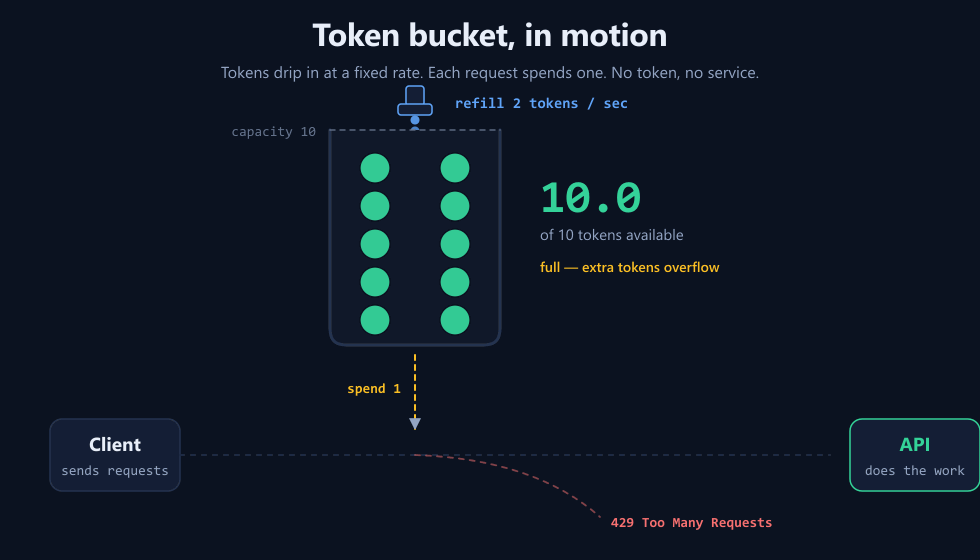

🎬 Native clip: [`videos/token-bucket.mp4`](videos/token-bucket.mp4)

Two numbers now describe two different promises:

- **Refill rate** is the sustainable average: 2 tokens/sec means 2 requests/sec over time.
- **Capacity** is the tolerated burst: a quiet caller can save at most 10 tokens, then spend all 10 immediately.

That separation fits how applications behave. Opening one React screen may trigger six API calls together, followed by silence. A fixed “2 requests every second” rule rejects ordinary page loading. A token bucket lets the small burst through but still prevents a caller from sustaining more than 2/sec.

You do not need a timer dripping tokens in the background. Refill lazily when a request arrives:

```js
function createTokenBucket({ capacity = 10, refillPerSec = 2 } = {}) {
  const state = new Map(); // key -> { tokens, last }

  return function check(key, now = Date.now(), cost = 1) {
    if (!Number.isFinite(now) || !Number.isFinite(cost) || cost <= 0) {
      throw new RangeError('now and cost must be valid');
    }
    if (cost > capacity) {
      return { allowed: false, reason: 'cost_exceeds_capacity', retryAfterMs: null };
    }

    const b = state.get(key) ?? { tokens: capacity, last: now };
    const effectiveNow = Math.max(now, b.last); // never persist a regressed clock
    const elapsedSec = (effectiveNow - b.last) / 1000;
    b.tokens = Math.min(capacity, b.tokens + elapsedSec * refillPerSec);
    b.last = effectiveNow;

    const allowed = b.tokens >= cost;
    if (allowed) b.tokens -= cost;
    state.set(key, b);

    return {
      allowed,
      tokens: b.tokens,
      retryAfterMs: allowed
        ? 0
        : Math.ceil(((cost - b.tokens) / refillPerSec) * 1000),
    };
  };
}
```

The formula is the algorithm:

```txt
new balance = min(capacity, old balance + elapsed seconds × refill rate)
```

The `min` matters. Without it, a user who was idle for a week could bank a week of tokens and release them in one burst.

The optional `cost` parameter is our first clue that “one request” may not be the right unit. We will return to it in Act IV.

### Pause and predict

Capacity is 10 and refill is 2/sec. A full bucket receives 12 requests at once.

<details>
<summary>Reveal the answer</summary>

Ten pass. Two are rejected. The first rejected request should wait about 500ms for one token.

</details>

---

## Scene 6: leaky bucket—the name with two meanings

In the classic traffic-shaping version, requests enter a queue and leave at a constant rate. A burst becomes waiting time instead of a burst hitting the downstream service.

```txt
burst in:   ||||||||||
steady out: |  |  |  |  |  |
```

That is useful when the receiver needs smooth traffic and latency is acceptable. It is dangerous when the queue can grow without a bound; then your “limiter” is only moving the outage into memory.

The vocabulary is messy in the real world. Some API documentation uses “leaky bucket” for a budget that restores continuously, which behaves like the mirror image of a token bucket. Shopify uses that bucket model and lets short bursts through while restoring capacity over time ([Shopify API limits](https://shopify.dev/docs/api/usage/limits)). When reading documentation, inspect the behavior rather than trusting the label.

---

## Scene 7: GCRA—the one-timestamp magician

The Generic Cell Rate Algorithm came from network scheduling. Instead of storing tokens or timestamps, it stores one number: the **theoretical arrival time** (`TAT`) of the next request.

For 10 requests/sec, requests should be spaced 100ms apart. A successful request moves the theoretical schedule 100ms into the future. Burst tolerance says how far ahead of real time the caller may run.

```js
function createGCRA({ limit = 10, periodMs = 1000, burst = 5 } = {}) {
  const state = new Map(); // key -> one timestamp
  const interval = periodMs / limit;
  const tolerance = interval * burst;

  return function check(key, now = Date.now(), cost = 1) {
    if (!Number.isFinite(now) || !Number.isFinite(cost) || cost <= 0) {
      throw new RangeError('now and cost must be valid');
    }
    if (cost > burst) {
      return { allowed: false, reason: 'cost_exceeds_burst', retryAfterMs: null };
    }

    const tat = Math.max(state.get(key) ?? now, now);
    const next = tat + interval * cost;
    const allowAt = next - tolerance;

    if (now < allowAt) {
      return { allowed: false, retryAfterMs: Math.ceil(allowAt - now) };
    }

    state.set(key, next);
    return { allowed: true, retryAfterMs: 0 };
  };
}
```

GCRA gives admissible requests smooth rolling behavior, bounded bursts, exact retry timing, and one value per key. A weighted request larger than the configured burst is terminally impossible and should return `cost_exceeds_burst`, not a retry time that repeats forever. That compact state is why systems such as `redis-cell` implement GCRA as a single Redis operation ([Brandur Leach's GCRA explanation](https://brandur.org/rate-limiting), [Redis's redis-cell overview](https://redis.io/blog/redis-cell-rate-limiting-redis-module/)).

You do not need GCRA on your first endpoint. You should know why it exists.

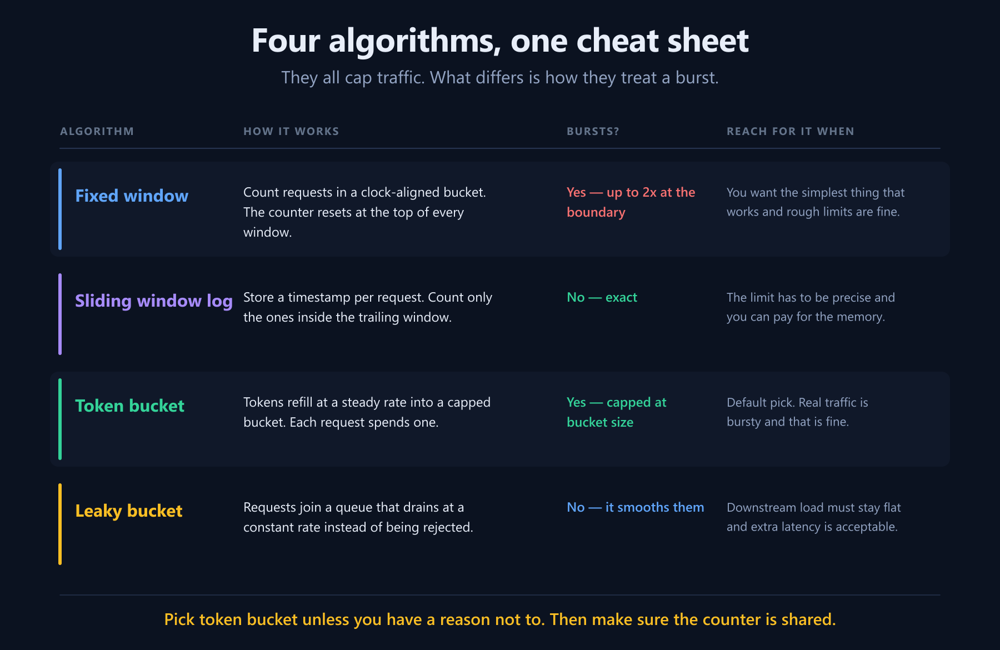

### Act I checkpoint

| Need | First choice |
|---|---|
| A cheap coarse cap | Fixed window |
| Exact trailing-window fairness | Sliding log |
| Constant memory approximation | Sliding counter |
| Sustainable rate plus a friendly burst | Token bucket |
| Flat output through a queue | Leaky bucket |
| Smooth rolling enforcement with tiny state | GCRA |

The full, executable versions of all six are in [`code/phase1-bare/limiters.mjs`](code/phase1-bare/limiters.mjs).

---

## The Act I post-credits scene: the code works, but the process does not

Our `Map` implementations have four production problems.

### 1. State grows forever

Every new key creates an entry. If attackers invent keys, memory becomes the target. Add expiry and a sweeper, use an LRU, or move state to a store with TTL.

This is a **cardinality attack**: the attacker does not need to exceed a per-key limit if they can create unlimited keys.

### 2. Wall clocks can jump

`Date.now()` may move when a machine's clock is corrected. For elapsed time inside one process, a monotonic clock such as `performance.now()` is safer. Across processes, synchronize clocks or choose a central time source deliberately.

### 3. The identity may be wrong

IP address is a fallback, not a person.

- An office, university, or mobile carrier may put many users behind one NAT address.
- An attacker can rotate proxies.
- IPv6 gives clients ranges, so raw addresses can create fresh budgets. Popular Node middleware exposes helpers that group IPv6 addresses by subnet for this reason.
- If Express is behind a proxy, configure `trust proxy` correctly or `req.ip` may be the load balancer—or a spoofable header.

Prefer an authenticated customer or API-key ID. Compose keys around the policy you intend:

```txt
rl:{tenant-123}:search
rl:{tenant-123}:pdf-export
rl:{api-key-abc}:model:gpt-x
```

### 4. A second process creates a second truth

That is our cliffhanger.

---

# Act II — One Shared Brain

## Scene 1: the deploy that multiplies the limit

Your laptop runs one Node process. The `Map` says a customer has used 80 of 100 requests.

Production runs three pods. Each pod has a different `Map` and each grants 100.

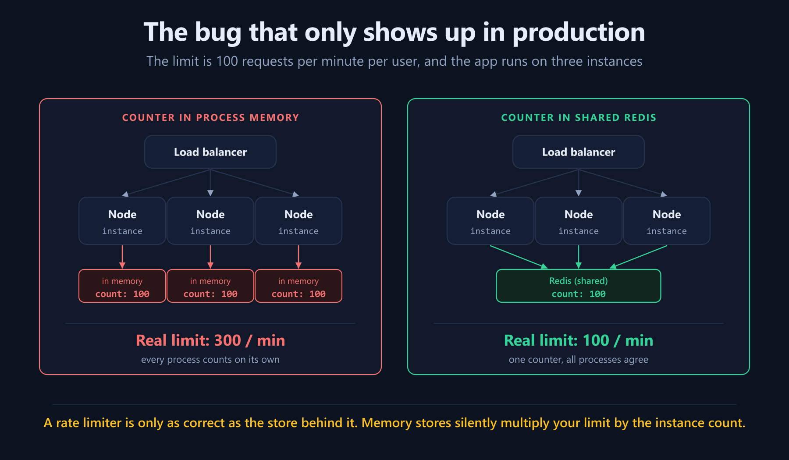

The code did not become wrong when you deployed it. Its **scope** became wrong.

Move ephemeral limiter state to Redis and every process asks one shared authority.

Redis is a natural fit because it gives us:

- atomic primitives such as `INCR`;
- key expiry;
- sorted sets for sliding logs;
- hashes for token state;
- Lua scripts that turn a multi-step decision into one atomic operation.

Redis's own rate-limiting guides use the same model: shared state, atomic scripts, and TTL ([Redis rate limiter documentation](https://redis.io/docs/latest/develop/use-cases/rate-limiter/), [Redis Node token-bucket guide](https://redis.io/docs/latest/develop/use-cases/rate-limiter/nodejs/)).

---

## Scene 2: “Redis is single-threaded” is not the end of the story

This code is still wrong:

```js
const current = Number(await redis.get(key) ?? 0); // round trip 1
if (current >= limit) return false;                // decision in Node
await redis.set(key, current + 1);                 // round trip 2
return true;
```

Suppose the count is 99 and the cap is 100.

1. Pod A reads 99.
2. Pod B reads 99 before A writes.
3. Both decide that one slot remains.
4. Both serve a request.
5. Both write 100.

Two requests were served against one slot, and the final counter says 100. Your metrics cannot even reveal the overshoot.

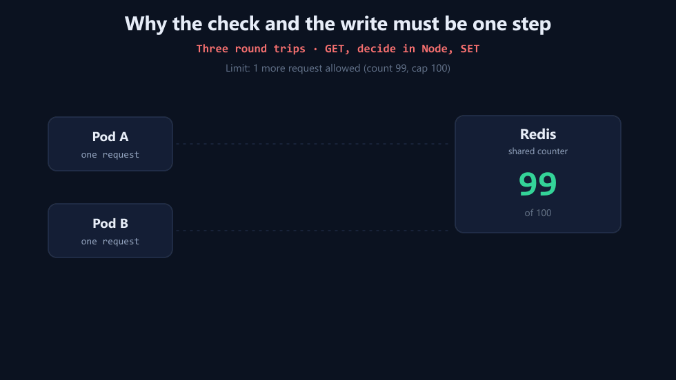

🎬 Native clip: [`videos/redis-race.mp4`](videos/redis-race.mp4)

“Each Redis command is atomic” does not mean “my workflow of three commands is atomic.” The fix is to move read → decide → write into one Lua script. Redis runs that script with no other command interleaved.

### An atomic fixed-window script

The key already contains the numbered clock window. Node passes the milliseconds left until the real boundary as `ARGV[2]`:

```lua
local limit = tonumber(ARGV[1])
local ttl   = tonumber(ARGV[2])

-- Validate before writing: script errors do not roll back earlier writes.
if limit == nil or limit <= 0 or limit ~= math.floor(limit)
   or ttl == nil or ttl <= 0 or ttl ~= math.floor(ttl) then
  return { -2, 0, 0 }
end

local count = redis.call('INCR', KEYS[1])
if count == 1 then
  redis.call('PEXPIRE', KEYS[1], ttl)
end

local remaining_ttl = redis.call('PTTL', KEYS[1])
if count > limit then
  return { 0, 0, remaining_ttl }
end
return { 1, limit - count, remaining_ttl }
```

`INCR` and `PEXPIRE` belong in the same script. If your process dies after an `INCR` but before a separate `EXPIRE`, the key can become immortal and that user can remain blocked forever.

The complete sliding-log, token-bucket, and GCRA scripts are in [`code/phase2-redis/scripts.mjs`](code/phase2-redis/scripts.mjs). They run through the wrapper in [`code/phase2-redis/limiter.mjs`](code/phase2-redis/limiter.mjs).

### Four details hidden inside good Lua

**Return fractional values as strings.** Redis converts Lua numeric replies to integers. A token balance of `0.5` can arrive as `0` unless the script returns `tostring(tokens)`.

**Expire every state key.** The TTL should be long enough that an idle bucket can refill fully, then disappear. Pass Redis expiry durations as positive integers—round a fractional clock-boundary remainder upward before the script runs—and validate again in Lua before the first mutation. Without TTL, identity cardinality turns Redis into an unbounded user registry.

**Choose your clock.** Passing app time in `ARGV` keeps scripts deterministic and avoids some replication concerns, but your app hosts need synchronized clocks. Calling Redis `TIME` centralizes the clock but couples the algorithm to Redis time semantics. Pick; do not drift into a choice accidentally.

**Keep multi-key scripts in one Redis Cluster slot.** A script that touches `used`, `pending-units`, and `pending-requests` will fail in cluster mode if those keys hash to different slots. Put the same hash tag inside braces in all of them:

```txt
quota:{tenant-123:2026-10}:used
quota:{tenant-123:2026-10}:pending:units
quota:{tenant-123:2026-10}:pending:requests
```

Redis hashes only the text inside `{...}`, so the three keys travel together. The Phase III implementation does this and tests it.

---

## Scene 3: the Redis-only implementation shape

```js
const limiter = createRedisLimiter({
  eval: (script, keys, args) =>
    redis.eval(script, { keys, arguments: args.map(String) }),
  prefix: 'rl:',
  failOpen: true,
  onError: err => metrics.increment('rate_limiter.redis_error'),
});

app.use('/api', rateLimitMiddleware(limiter, {
  keyOf: req => req.user?.customerId ?? ipKeyGenerator(req.ip),
  capacity: 20,
  refillPerSec: 5,
  costOf: req => req.path === '/search' ? 5 : 1,
}));
```

Now one budget applies across every pod. The wrapper is deliberately readable, not a claim that one file completes Redis operations.

### The Redis production checklist

- **Use `EVALSHA` or Redis Functions**, not full script text on every request; handle script cache misses after failover.
- **Bound Redis latency** with connection and command timeouts. A limiter that waits forever has become the outage.
- **Choose persistence and eviction deliberately.** Disposable request counters can tolerate loss; quota state often requires AOF/replication and `noeviction`.
- **Understand asynchronous failover.** A successful primary write may not have reached a replica before promotion. `WAIT` can reduce that window by waiting for replicas, at the cost of latency; it is not a replacement for a durable financial ledger.
- **Keep scripts short.** Redis executes Lua atomically, so a long script blocks other work.
- **Watch hot keys.** One global key serializes the world on one shard. Prefer per-tenant/per-route keys and separate fleet-level controls.
- **Test a real Redis Cluster.** A Lua VM proves algorithm branches; it does not prove failover, slot routing, persistence, eviction, or cluster-wide scans.

### Fail open or fail closed?

When Redis is unavailable, you have to choose another failure mode.

- **Fail open:** serve the request. Good for general API availability when the limiter is protection, not authorization.
- **Fail closed:** reject the request. Good when serving it could create an unacceptable security or financial event—password guessing, an LLM cost cap, or a hard contractual quota.
- **Degrade locally:** use a smaller emergency in-process limit until Redis recovers. This preserves some protection while admitting that the limit is no longer globally exact.

Stripe describes catching limiter failures so limiter bugs do not take down the API, adding kill switches, observing decisions, and dark-launching before enforcement ([Stripe Engineering](https://stripe.com/blog/rate-limiters)). That is a sensible default for a broad request limiter. It is not a universal answer for every endpoint.

---

## Scene 4: send an actionable rejection

`429 Too Many Requests` was defined by [RFC 6585](https://datatracker.ietf.org/doc/html/rfc6585). A useful, cache-resistant rejection includes enough information for a cooperative client to recover:

```http
HTTP/1.1 429 Too Many Requests
Retry-After: 12
Cache-Control: private, no-store
Content-Type: application/json

{
  "error": "rate_limited",
  "message": "Request rejected by the rate policy.",
  "retry_after_ms": 12000
}
```

`Retry-After` is standardized and may contain seconds or an HTTP date. The richer `RateLimit`/`RateLimit-Policy` fields are still evolving through the IETF HTTPAPI process, and draft grammar has changed. If you emit them, pin one draft version across server, gateway, SDK, and documentation instead of copying a header from a different draft ([current IETF draft](https://www.ietf.org/archive/id/draft-ietf-httpapi-ratelimit-headers-11.html)).

Status codes describe the kind of decision, not an unbreakable scope law:

- `429`: a configured rate policy rejected this request; the counting scope is defined by that policy.
- `503`: the service is temporarily unavailable, commonly used when global overload shedding is the reason.
- `403`: the action is forbidden, not temporarily over budget.
- `402` is not a universal “quota exhausted” contract; document your own commercial error clearly.

### Act II checkpoint

Redis solved distribution and atomicity. It did **not** make the counter durable business truth.

If Redis restarts and every request counter resets, that is usually acceptable. If Redis restarts and a customer receives a second free monthly allowance, it is not.

Cut to Act III.

---

# Act III — Speed and Truth

## Scene 1: a rate limit and a quota walk into a database

A rate limit protects a moment:

```txt
Can customer A send this request right now?
```

A quota protects a period or contract:

```txt
Has customer A consumed its 1,000,000 units this month?
```

The first value changes on every request and can be reconstructed. The second may appear on an invoice and must survive a cache wipe.

The architecture is therefore not “Redis versus database.” It is “what belongs in each?”

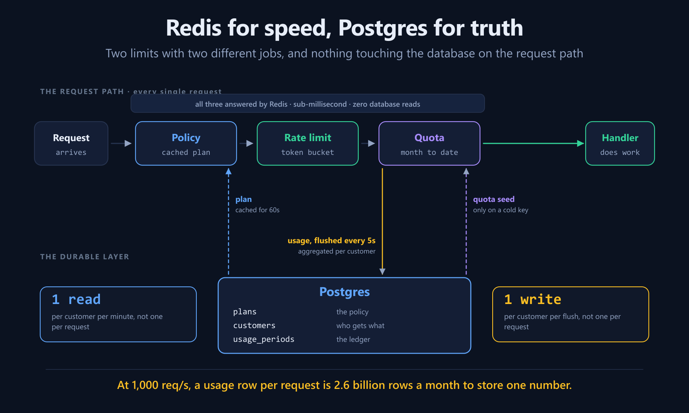

### Postgres owns

- plans and customer overrides;
- suspension and entitlement state;
- durable usage per billing period;
- sampled/audited decisions you may need to explain later.

### Redis owns

- token balances and virtual timestamps;
- cached plan policy;
- the hot month-to-date counter;
- the unflushed usage delta.

### Do not synchronously update one aggregate row per request

At 1,000 requests/sec, updating one shared usage aggregate per request creates 2.6 billion write operations in a 30-day month, plus severe row contention, to recover a handful of totals. An append-only idempotent event per billable operation can be valid when exact accounting demands it; a synchronous hot-row increment usually is not.

Aggregate in Redis, rotate a UUID-tagged batch, then settle it idempotently:

```sql
BEGIN;

WITH accepted AS (
  INSERT INTO usage_flushes
    (flush_id, customer_id, period, units, requests)
  VALUES ($1, $2, $3, $4, $5)
  ON CONFLICT (flush_id) DO NOTHING
  RETURNING 1
)
INSERT INTO usage_periods (customer_id, period, units, requests)
SELECT $2, $3, $4, $5 FROM accepted
ON CONFLICT (customer_id, period) DO UPDATE
SET units      = usage_periods.units    + EXCLUDED.units,
    requests   = usage_periods.requests + EXCLUDED.requests,
    updated_at = now();

COMMIT;
```

If the same flush UUID is retried, `accepted` is empty and the aggregate does not move twice.

The full schema is in [`code/phase3-db-redis/schema.sql`](code/phase3-db-redis/schema.sql).

---

## Scene 2: keep the database off the hot path

A naive hybrid design reads Postgres before every request:

```txt
request → SELECT plan → SELECT usage → Redis → handler
```

That protects the database by placing the database inside every limiting decision. It defeats the point.

The verified companion design uses two cold-start handshakes.

### Policy cache

1. Look for `plan:{customer}` in Redis.
2. On a miss, read Postgres once.
3. Cache the resolved policy for 60 seconds.
4. Invalidate it immediately when a plan changes.

A popular tenant can cause a cache-miss stampede: hundreds of requests all miss together and query Postgres. Collapse concurrent misses with single-flight/locking, briefly negative-cache unknown customers, and version policies so stale invalidation messages cannot overwrite a newer plan. A TTL is the safety net; an event or explicit invalidation is the fast path.

### Settled quota seed

1. Call the quota Lua script with a sentinel seed of `-1`.
2. If the running Redis key exists, the script decides immediately: zero database reads.
3. If the key is cold, the script returns `-1` without consuming anything.
4. Node reads durable usage from Postgres and retries the same atomic script with that seed.
5. If several pods cold-start together, only the first script seeds. The others see the key and continue from it.

Why not call `EXISTS`, then read Postgres on a miss? Because the key can expire between `EXISTS` and the quota script. Making the script declare “I am cold” closes that gap.

The complete implementation is [`code/phase3-db-redis/quota-service.mjs`](code/phase3-db-redis/quota-service.mjs).

---

## Scene 3: two gates, in the right order

```txt
policy / suspension
        ↓
per-second rate limit
        ↓
monthly quota reservation
        ↓
handler
```

The order carries semantics.

- A suspended customer should not consume a token.
- A request rejected by the fast rate limit should not consume monthly quota.
- A request rejected by quota should not reach the expensive handler.

In the tests, a free plan with burst capacity 5 and monthly quota 10 receives a burst of 12. Exactly 5 reach the quota gate. The other 7 receive `rate_limited` and consume zero monthly units.

### Keep units and requests separate

One request may cost 15 units. Store both:

```txt
units:    15
requests:  1
```

Do not increment “requests” by cost. That sounds obvious until one shared pending counter is reused for both and your analytics report fifteen calls that never happened. The companion implementation maintains separate write-behind deltas.

---

## Scene 4: write-behind needs an identity

Deleting a pending counter and then writing it to Postgres is not enough. A worker can die after deletion but before the database write, losing the batch. It can also observe an ambiguous database result and apply the same delta twice.

The companion implementation uses an idempotent processing-batch protocol:

1. A Lua script atomically rotates `pending:units` and `pending:requests` into an immutable processing hash.
2. The hash receives a UUID and keeps its original customer **and period**.
3. New requests immediately fill fresh pending counters.
4. One Postgres transaction inserts the UUID into `usage_flushes` and increments `usage_periods` only if that UUID was new.
5. Redis deletes the processing hash only after a confirmed commit.

The rotation script validates every argument before writing, refuses an already-existing processing ID, creates and expires the recoverable hash **before** deleting pending counters, and lets the caller generate another UUID on collision. That ordering is what makes “immutable batch” true rather than a label.

If a worker dies before the commit, the processing hash remains discoverable. If it dies after the commit but before Redis cleanup, the next worker replays the same UUID; Postgres recognizes it and does not add the batch twice.

The flusher scans outstanding periods rather than only “this month.” An October batch discovered at 00:00:02 in November is still written to October. In Redis Cluster, that scan must iterate every primary; production code must not use the blocking `KEYS` command.

The demo uses UTC calendar months. Real billing may use customer-specific anchors, grace windows for late events, period-closing watermarks, refunds, and manual adjustments. Treat the period as a versioned billing-domain value—not as `new Date().slice(0, 7)` scattered through request handlers.

This gives the write-behind path retry safety **as long as Redis still has the processing record**. It does not make Redis a durable billing system.

---

## Scene 5: name the guarantee before selling the quota

The Phase III design is a **bounded-loss operational quota**:

- settled usage is durable and idempotent in Postgres;
- hot checks normally touch only Redis;
- a cold key seeds from settled Postgres usage;
- worker crashes around a flush are safely retried by batch UUID;
- total Redis loss can still lose accepted usage that has not reached an immutable processing batch.

Configure limiter Redis deliberately: persistence appropriate to the risk, replication/failover monitoring, and usually `maxmemory-policy noeviction` for quota state. A partial eviction of the running usage key while pending state survives can otherwise under-seed the next hot counter. The manual rehydration helper refuses to run while unsettled records exist for this reason.

After **durable settlement**, a Redis wipe is safe: Postgres seeds the new counter and a customer already at quota remains at quota. Before settlement, the maximum loss is approximately the flush interval only if Redis disappears as a whole; persistence and failure timing decide the real bound.

If a contractual or financial cap may never overshoot, put a durable reservation/event on the acknowledgement path—typically an idempotent database transaction, durable stream, or outbox—and reconcile unknown outcomes. That costs more latency because the stronger guarantee is genuinely more expensive.

Engineering is often choosing and naming the size of a failure, not making failure impossible.

### Act III checkpoint

Choose the owner and guarantee:

| Data | Hot copy | Durable owner | Guarantee in this demo |
|---|---|---|---|
| Per-second token balance | Redis | none | disposable protection |
| Plan / customer override | Redis cache | Postgres | refresh + invalidation |
| Month-to-date running count | Redis | settled seed in Postgres | operational, bounded loss |
| Immutable flush identity | Redis processing hash | `usage_flushes` UUID | idempotent replay |
| Settled usage aggregate | Redis may cache it | Postgres | durable after commit |
| Hard financial reservation | not implemented here | durable transaction/event | required when overshoot is unacceptable |

We now have correct fast limits and an explicit durability boundary instead of pretending every quota has the same guarantee.

Then the unit “request” betrays us.

---

# Act IV — Past Requests Per Second

## Scene 1: duration—the request that refuses to leave

Two endpoints both receive 2 requests/sec.

- Endpoint A returns in 50ms.
- Endpoint B renders a PDF in 6 seconds.

A request-rate limiter sees identical traffic. The server does not.

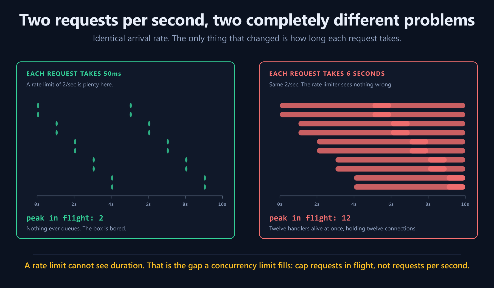

This is an application of Little's Law:

```txt
average work in flight ≈ arrival rate × average time in system
```

At 2/sec and 50ms, average concurrency is roughly 0.1. At 2/sec and 6 seconds, it is roughly 12.

Stripe describes running a concurrent-request limiter specifically for expensive endpoints: instead of “N calls per second,” it says “at most N calls currently in progress” ([Stripe Engineering](https://stripe.com/blog/rate-limiters)).

A safe local primitive looks like this:

```js
const slot = limiter.tryAcquire(customerId);
if (!slot.acquired) return res.status(429).end();

try {
  await renderPdf();
} finally {
  slot.release(); // errors must not leak capacity
}
```

The `finally` is the feature. A leaked slot slowly turns a healthy service into a permanently full one.

The tested implementation, including idempotent release, per-key and aggregate queue bounds, deadlines, and abort handling, is in [`code/phase4-beyond/concurrency.mjs`](code/phase4-beyond/concurrency.mjs).

Its scope is deliberately one Node process. A cross-pod concurrency cap cannot be a bare Redis `INCR`: if a pod dies before decrementing, capacity leaks forever. Distributed designs use owner routing or leased slot IDs with TTL, heartbeat, and fencing. Also decide whether the cap protects one customer, one endpoint, one downstream pool, each worker, or the whole fleet—those are different semaphores.

---

## Scene 2: cost—the one-million-node “single request”

Consider four requests:

```txt
GET /health                              cost 1
GET /search?q=...                       cost 20
POST /chat with 3,000 tokens         cost 3,000
GraphQL users(100) → posts(100)
                  → comments(100)  cost 1,010,100
```

A request counter calls all four “1.”

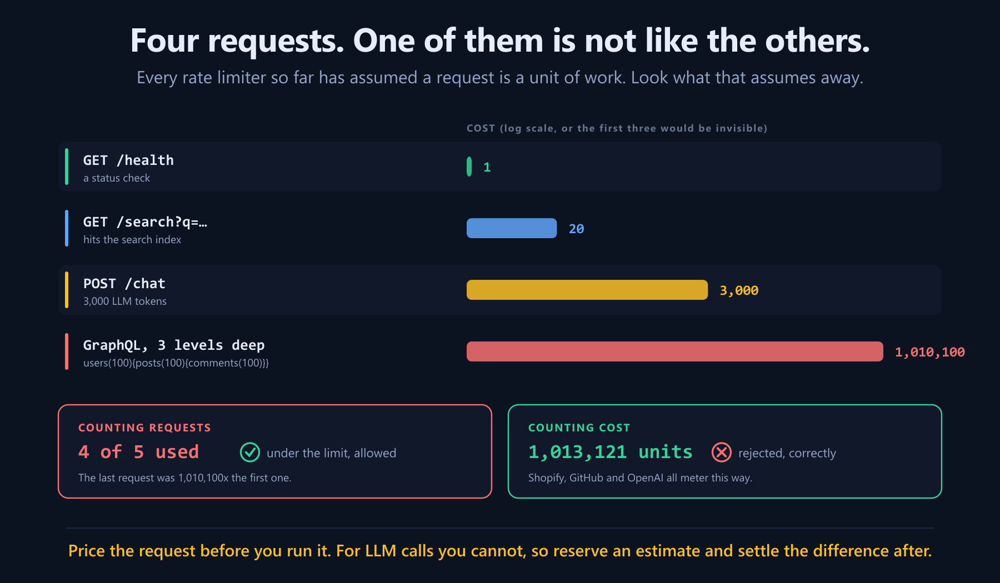

Real APIs meter the thing they actually protect:

- Shopify's GraphQL Admin API uses calculated query cost and a restoring bucket rather than treating every query equally ([Shopify GraphQL limits](https://shopify.dev/docs/apps/build/apis/graphql-admin/rate-limits)).
- GitHub combines primary hourly request limits with secondary limits involving points, concurrency, and compute pressure ([GitHub REST rate limits](https://docs.github.com/en/rest/using-the-rest-api/rate-limits-for-the-rest-api)).
- OpenAI documents multiple dimensions such as requests and tokens over minute/day periods; whichever budget is exhausted first constrains the call ([OpenAI rate-limit guide](https://developers.openai.com/api/docs/guides/rate-limits)).

The principle is broader than those products:

> Charge in the unit that predicts load or cost.

That unit could be rows scanned, bytes exported, recipients emailed, images generated, database statements, or estimated CPU milliseconds.

---

## Scene 3: reserve now, settle later

GraphQL cost can often be estimated before execution. An LLM call's final output-token count is not known until it finishes.

Charging only afterwards creates a race:

1. The organization has 10,000 tokens left.
2. Four calls begin together, each expecting to use 3,000.
3. All four see 10,000 available.
4. They finish having used 12,000.

The answer is the same pattern hotels use with credit cards:

1. **Reserve** an estimated maximum before the call.
2. Reject if the reservation does not fit.
3. Run the call.
4. **Settle** the actual cost—refund unused units or charge the difference.
5. **Cancel** the reservation if the call never happened.

```js
const reservationId = crypto.randomUUID();
const hold = await budgets.reserve({
  reservationId,
  orgId,
  estimatedTokens,
});
if (!hold.ok) return res.status(429).json(hold);

try {
  const result = await callModel({
    idempotencyKey: reservationId,
  });
  await budgets.settle(reservationId, result.usage.total_tokens);
  return result;
} catch (error) {
  if (error.definitelyNeverSent) {
    await budgets.cancel(reservationId);
  } else {
    // A timeout is an unknown outcome: the provider may have completed and
    // billed the call. Preserve the reservation and reconcile it later.
    await budgets.markUnknown(reservationId);
  }
  throw error;
}
```

The in-memory teaching version and a dual RPM+TPM limiter are in [`code/phase4-beyond/cost.mjs`](code/phase4-beyond/cost.mjs). It validates the token estimate before consuming an RPM slot, preserves excess actual cost as debt instead of clamping it away, and lets an invalid settlement be corrected rather than terminalizing the reservation. A settled reservation cannot later be cancelled. Across pods or restarts, use a durable reservation ID and an atomic `RESERVED → SETTLED | CANCELLED | UNKNOWN` state machine.

This is where idempotency and unknown outcomes become part of rate limiting rather than “billing details.”

---

## Scene 4: the safe limit moves

You benchmark the endpoint and choose concurrency 40.

Tomorrow:

- the database replica is slower;
- a noisy neighbor steals CPU;
- the cache hit rate falls;
- the downstream deploys a regression;
- or you resize the instance and 40 becomes unnecessarily conservative.

A static number cannot know.

TCP has always had the same problem: it does not know available network capacity in advance. It probes, watches for congestion, and backs off. Netflix applied that family of ideas to service concurrency in its open-source `concurrency-limits` work, aiming to find useful throughput while controlling latency ([Netflix repository](https://github.com/Netflix/concurrency-limits), [Netflix TechBlog](https://netflixtechblog.medium.com/performance-under-load-3e6fa9a60581)).

A Vegas-shaped controller demonstration tracks the best observed latency and estimates how much work is merely waiting:

```txt
estimated queue ≈ limit × (1 - minimum latency / current latency)
```

If latency is close to the minimum, increase cautiously. If latency rises and the implied queue grows, decrease. A hard failure causes a larger cut.

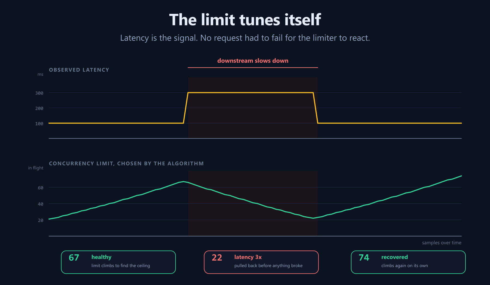

The chart is generated from the feedback-controller demonstration in [`code/phase4-beyond/adaptive.mjs`](code/phase4-beyond/adaptive.mjs), not drawn to tell a convenient story. It is intentionally not a drop-in copy of Netflix or TCP: production controllers aggregate and smooth sample windows, filter app-limited periods, account for feedback delay, and connect the chosen number to a real admission semaphore. In this demonstration, latency rises from 100ms to 300ms; the limit falls before any request fails; when latency recovers, the limit climbs again.

The minimum-latency baseline never resets itself while congested—a slow sample must not become the new definition of “healthy,” and a failed/dropped sample is a congestion signal rather than evidence of a faster baseline. Reset or probe the baseline only during controlled low load or after a known topology change.

Adaptive control does not remove the need for maximums, minimums, hysteresis, metrics, or a kill switch. It removes the fantasy that one benchmark found a permanent number.

---

## Scene 5: the building is already on fire

Rate limiting asks:

```txt
Has this caller consumed too much?
```

Load shedding asks:

```txt
Can the system safely accept this work at all?
```

During an incident, the answer may be “no” even for a caller comfortably below every personal limit.

The companion `createLoadShedder` is a probability-controller demonstration: utilization is converted into per-priority targets, and admission uses slowly ramped values rather than reacting instantly. Marking a class “critical” does not reserve capacity by itself. Pair the shedder with a hard total concurrency cap and a bounded pool reserved for critical work; otherwise enough critical traffic can still collapse the service.

Stripe describes reserving fleet capacity for critical operations and progressively shedding categories as workers saturate—test traffic before reads, reads before writes, while preserving critical calls as long as possible. It also warns that shedding and restoring too quickly creates flapping ([Stripe Engineering](https://stripe.com/blog/rate-limiters)). Google's SRE material likewise treats graceful overload handling and load shedding as core reliability tools ([Google SRE: handling overload](https://sre.google/sre-book/handling-overload/)).

Imagine an e-commerce platform during a database slowdown:

1. product recommendations disappear;
2. analytics exports receive `503`;
3. catalog reads become partially cached;
4. cart writes continue;
5. checkout retains reserved capacity.

That is not unfair. It is the system choosing a smaller failure over a total failure.

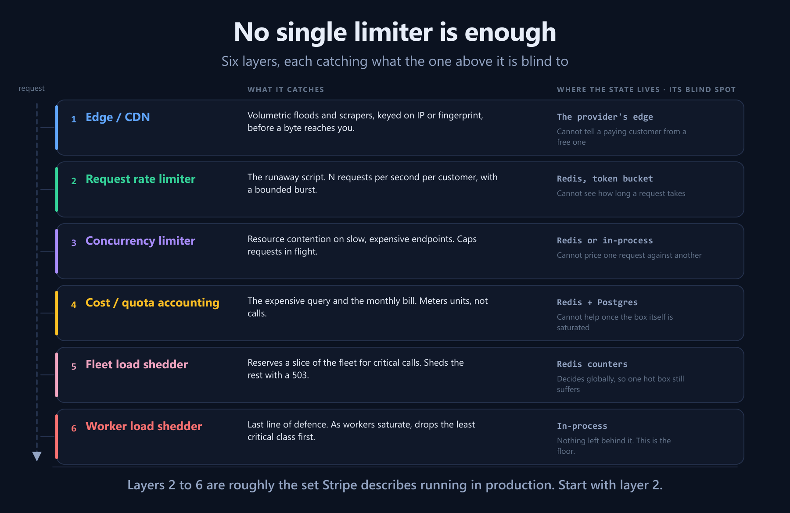

No single layer replaces the others:

1. edge rules absorb volumetric abuse;
2. request rate limits preserve caller fairness;
3. concurrency limits cap work held in flight;
4. cost and quota limits protect expensive dimensions and contracts;
5. fleet shedding reserves global critical capacity;
6. worker shedding protects each process as the last line of defence.

---

## Scene 6: the multi-region boss battle

One global exact limit sounds ideal until every request in Singapore must coordinate with a counter in Virginia.

You can have globally exact ordering, low latency, and tolerance of a region/network failure—but not all three without paying heavily in architecture and availability.

Common strategies:

### Home-region ownership

Hash each customer to one region and send its limiter decisions there. Exact per customer, but a home-region failure needs a migration story.

### Divide the budget

A limit of 1,000 becomes 500 in each of two regions. Fast and independent, but unused capacity in one region cannot immediately help the other.

### Local soft limit plus a global durable ledger

Each region grants a conservative local rate. Durable usage converges into a global ledger. You accept a bounded overshoot in exchange for availability; if overshoot is forbidden, the durable reservation must join the acknowledgement path.

### Edge enforcement

Push coarse IP/device abuse limits into a CDN/WAF, while authenticated commercial limits stay in your application. Cloudflare emphasizes that edge enforcement keeps excess traffic away from the origin ([Cloudflare Engineering](https://blog.cloudflare.com/counting-things-a-lot-of-different-things)).

When someone asks for “a global rate limiter,” ask the follow-up question:

> How much overshoot is acceptable during a partition?

That answer determines the design more than the algorithm name.

---

# Reverse angle — You are the client now

Your service calls an upstream API. It returns `429`.

The worst response is an immediate retry. If hundreds of clients retry on the same fixed interval, they form synchronized spikes. The recovering service never gets a quiet moment.

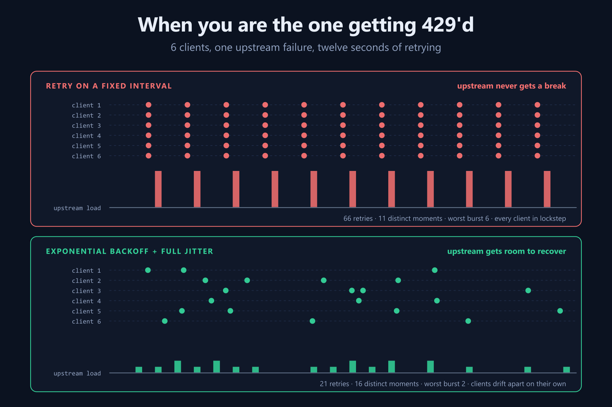

Exponential backoff grows the retry window. **Jitter** stops independent clients from selecting the same point in that window. AWS's canonical analysis shows why backoff alone still clusters work and why randomized delay reduces contention ([AWS Architecture Blog](https://aws.amazon.com/blogs/architecture/exponential-backoff-and-jitter/)).

A safer helper makes the dangerous choices explicit. It accepts an **options factory**, so a streamed/body request can create a fresh body per attempt; it retries only selected transient statuses; it enforces per-attempt and total deadlines; and it will not replay a non-idempotent operation unless the caller provides an idempotency key that the upstream actually honors.

```js
import { fetchWithBackoff } from './client-retry.mjs';

const operationKey = crypto.randomUUID();

const response = await fetchWithBackoff(
  'https://api.example.com/jobs',
  () => ({
    method: 'POST',
    headers: {
      'Content-Type': 'application/json',
      'Idempotency-Key': operationKey, // identical on every attempt
    },
    body: JSON.stringify(buildFreshPayload()),
  }),
  {
    maxAttempts: 5,
    attemptTimeoutMs: 10_000,
    totalTimeoutMs: 45_000,
    signal: request.signal,
  },
);
```

The verified helper is [`code/phase4-beyond/client-retry.mjs`](code/phase4-beyond/client-retry.mjs). Its less-visible rules are the important part:

- it accepts only integer `Retry-After` delta-seconds or a valid HTTP date;
- it captures the first normalized method and non-blank idempotency key, then refuses a changed identity;
- a keyless `POST` receives its transient response untouched instead of being secretly delayed and replayed;
- each attempt timeout is capped by the remaining **monotonic** total deadline;
- caller cancellation stops both fetch and sleep;
- `Retry-After` is a floor, then a full-jitter window is added—even when the floor is zero;
- a response body is cancelled only after the helper has committed to another attempt.

The idempotency header is useful only when the upstream documents and enforces it. The options factory creates a fresh body or stream for each attempt. `AbortSignal.timeout` and `AbortSignal.any` are available in current Node and modern browsers; use your platform's controller equivalent elsewhere.

Production rules around the helper:

- A timeout is an unknown outcome. A non-idempotent operation may have succeeded remotely even though you saw no response.
- Give retries both attempt and wall-clock budgets. Infinite retries are an outage amplifier.
- Retry at one layer. If SDK, service, queue worker, and gateway each try three times, one failure can become `3 × 3 × 3 × 3 = 81` calls.
- Treat `Retry-After` as a minimum. The helper spreads clients slightly later, never earlier.
- Unsuccessful calls still consume capacity on many APIs, so retry storms can exhaust the very quota they are trying to recover from.

---

# The director's cut — designing a policy that matches reality

## Start from the bottleneck, not a round number

“100 requests per minute” is not a design. It is a number wearing a design costume.

Suppose:

- the database safely handles 300 queries/sec;
- each API call uses 2 queries on average;
- you reserve 30% for internal and critical traffic;
- there are 20 active tenants.

A rough shared budget is:

```txt
300 DB queries/sec ÷ 2 queries/request = 150 requests/sec
150 × 70% allocatable                 = 105 requests/sec
105 ÷ 20 active tenants               ≈ 5 requests/sec each
```

Then give a bounded burst—perhaps 20—because real traffic is uneven. Measure, dark-launch, and adjust. Do not confuse this rough fairness allocation with the fleet's global capacity limit.

## Choose the key deliberately

A mature API often runs several budgets at once:

```txt
per IP             → anonymous abuse
per account        → login attempts against one victim
per API key        → integration contract
per tenant         → noisy-neighbor fairness
per endpoint       → expensive route protection
per model          → LLM deployment capacity
global             → fleet safety
```

For login, both dimensions matter:

- per source: one bot should not try thousands of accounts;
- per account: thousands of bots should not target one account.

Rate limiting is useful against abuse but is not a complete DDoS defense. Application code should not be your first and only line against traffic large enough to saturate the network.

## Bound every queue

Queues turn rejection into latency. An unbounded queue turns overload into memory growth, timeouts, and stale work. Set per-key **and aggregate** length limits, maximum wait time, and cancellation on client disconnect. Once any bound is exceeded, reject.

Queue discipline matters too. Pure FIFO can let one slow, expensive item block cheap work behind it; strict priority can starve low-priority work forever. Consider separate bounded pools or weighted fair queues, and propagate deadlines so work that can no longer produce a useful response is dropped before execution.

## Decide whether rejected work consumes budget

Usually:

- requests blocked by the fast rate gate do not consume monthly quota;
- a request that reaches the expensive downstream may consume cost even if it later fails;
- invalid requests may or may not consume request rate, depending on whether parsing/authentication itself is what you protect.

Write the rule down. Inconsistent charging is harder for clients than a strict policy.

---

# How to launch without becoming the incident

Stripe's “dark launch” advice deserves a concrete sequence.

## Phase 0: observe only

Run every decision but never reject. Emit:

```txt
rate_limit_decisions_total{route, plan, outcome, reason}
rate_limit_check_duration_seconds
rate_limit_store_errors_total
rate_limit_would_block_total
```

Do not put raw customer IDs into metric labels. That creates a high-cardinality observability bill. Put individual IDs in sampled structured logs or traces.

## Phase 1: headers only

Return remaining/reset policy hints while still serving. Clients can begin adapting.

## Phase 2: enforce for internal/test traffic

Find broken jobs before customers do.

## Phase 3: enforce a tiny percentage

Start at 1%, compare errors, latency, support signals, and revenue-sensitive flows.

## Phase 4: enforce broadly with a kill switch

Keep the ability to disable by endpoint, plan, or region without a deploy.

### Watch these signals

- allowed, rejected, and would-have-rejected counts by rule;
- limiter decision latency at p50/p95/p99;
- Redis errors and fail-open/fail-closed decisions;
- unique-key cardinality and memory;
- queue depth and wait time;
- rate-limit rejections versus upstream 5xx/latency;
- Redis hot count versus durable usage divergence;
- client retry rate after 429;
- percentage of critical traffic served during shedding.

A rejection rate of zero does not prove the limiter is healthy. It may prove the middleware is not running.

---

# The test suite I would demand in review

The companion tests use injected clocks so a minute passes instantly. At minimum, test:

### Boundaries

- the request just before a window edge;
- the request exactly on the edge;
- the 2× fixed-window burst;
- timestamps aging out of a sliding window.

### Bursts and refill

- an empty token bucket;
- exactly one fractional token refilling;
- a week of idle time still capped at capacity;
- a cost larger than one;
- GCRA's exact retry-after.

### Concurrency

- 100 simultaneous checks against a limit of 10;
- errors and client disconnects release slots;
- double release does not corrupt state;
- queues stop at their configured bound.

### Distribution

- two pods race on the last slot;
- the naive GET/check/SET overshoots;
- the Lua script does not;
- multi-key scripts use Redis Cluster hash tags when keys must share a slot.

### Failure

- Redis timeout under fail-open and fail-closed policies;
- stale policy cache and explicit invalidation;
- Redis wipe after settlement followed by cold quota seeding;
- database failure while an immutable processing batch waits;
- worker crash after a database commit but before Redis cleanup;
- cardinality attack with millions of invented identities.

### Properties, not just examples

Useful invariants:

```txt
0 ≤ token balance ≤ capacity
successful calls never exceed fixed-window limit inside one window
GCRA TAT never moves backward
in-flight count never falls below zero
settling one reservation twice changes nothing
a rejected rate check never increments monthly usage
```

The included deterministic suites exercise these core invariants, the Redis check/write race, clock regressions, queue timeout/cancellation, cold quota seeding, crash-before/after-commit replay, and month rollover. The Redis Lua executes inside a real Lua 5.3 VM wired to a Redis-command test double.

That still does **not** prove real Redis/Cluster/Postgres behavior. Before deployment, add integration tests for slot routing, script deployment, failover/replication loss, persistence and eviction, command timeouts, process death at injected failpoints, client disconnects, and database transaction isolation. The package calls itself verified teaching code—not a certified distributed system.

---

# The final decision tree

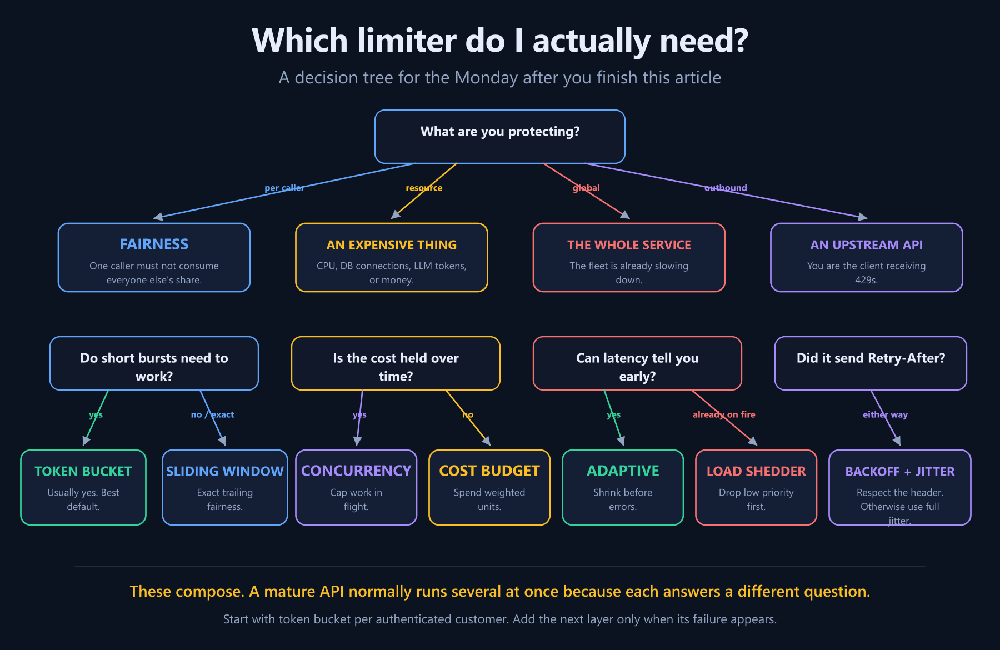

The shortest useful recommendation is:

1. Start with a token bucket per authenticated customer.
2. Put it in memory while learning or while running exactly one process.
3. Move the decision atomically to Redis before scaling out.
4. Put policy and durable quota totals in Postgres; keep Postgres off the hot path.
5. Add concurrency limits to long-running work.
6. Add weighted cost when requests are not interchangeable.
7. Add adaptive concurrency when the safe number changes with latency.
8. Add priority load shedding before the incident that teaches you why.
9. Return an actionable `429`; treat global overload as a different problem.
10. On the client side, respect `Retry-After`, cap retries, and add full jitter.

---

# End credits: what the bouncer was really doing

At the beginning, rate limiting looked like a counter at a nightclub door.

By the end, it became a set of explicit choices:

- identity: whose budget is this?
- dimension: requests, cost, concurrency, or time?
- scope: process, cluster, region, or world?
- state: disposable cache or durable truth?
- failure: open, closed, queued, or shed?
- priority: which work must survive when not everything can?
- feedback: is the limit fixed, or can the system discover it?

That is the deeper lesson.

A rate limiter is not middleware that says “no.”

It is a small scheduler. It decides how shared capacity is divided when demand exceeds supply. The algorithm determines the shape of the traffic. The key determines fairness. The store determines scope. The failure mode determines what happens on your worst day.

Fifteen lines can protect one Node process.

Redis can make the decision shared and atomic.

Postgres can make the commercial truth durable.

Concurrency, cost, adaptive control, and load shedding can make the policy resemble the real work.

And if the design is good, one broken client never gets to eat the API again.

---

## Hands-on files

- [`rate-limiting-playground.html`](rate-limiting-playground.html) — interactive, zero-dependency browser lab
- [`code/phase1-bare/limiters.mjs`](code/phase1-bare/limiters.mjs) — six algorithms with no Redis or database
- [`code/phase2-redis/scripts.mjs`](code/phase2-redis/scripts.mjs) — atomic Redis Lua scripts
- [`code/phase2-redis/limiter.mjs`](code/phase2-redis/limiter.mjs) — Redis wrapper and Express middleware
- [`code/phase3-db-redis/schema.sql`](code/phase3-db-redis/schema.sql) — Postgres policy and usage schema
- [`code/phase3-db-redis/quota-service.mjs`](code/phase3-db-redis/quota-service.mjs) — cached policy, cold quota seed, and idempotent processing batches
- [`code/phase4-beyond/concurrency.mjs`](code/phase4-beyond/concurrency.mjs) — bounded concurrent work
- [`code/phase4-beyond/cost.mjs`](code/phase4-beyond/cost.mjs) — cost estimation, reservation/settlement, RPM+TPM
- [`code/phase4-beyond/adaptive.mjs`](code/phase4-beyond/adaptive.mjs) — AIMD/Vegas-shaped controller and load-shedding demonstrations
- [`code/phase4-beyond/client-retry.mjs`](code/phase4-beyond/client-retry.mjs) — bounded, replay-aware client backoff
- [`tools/test-phase1.mjs`](tools/test-phase1.mjs) through [`tools/test-phase4.mjs`](tools/test-phase4.mjs) — executable verification

## Primary references

- [Stripe Engineering — Scaling your API with rate limiters](https://stripe.com/blog/rate-limiters)
- [Cloudflare Engineering — Counting things at scale](https://blog.cloudflare.com/counting-things-a-lot-of-different-things)
- [Redis — Rate-limiter use case](https://redis.io/docs/latest/develop/use-cases/rate-limiter/)
- [Redis — Token bucket with Node.js and Lua](https://redis.io/docs/latest/develop/use-cases/rate-limiter/nodejs/)
- [Brandur Leach — Rate limiting, cells, and GCRA](https://brandur.org/rate-limiting)
- [Shopify — API limits](https://shopify.dev/docs/api/usage/limits)
- [Shopify — GraphQL Admin API rate limits](https://shopify.dev/docs/apps/build/apis/graphql-admin/rate-limits)
- [GitHub — REST API rate limits](https://docs.github.com/en/rest/using-the-rest-api/rate-limits-for-the-rest-api)
- [OpenAI — Rate limits](https://developers.openai.com/api/docs/guides/rate-limits)
- [AWS Architecture Blog — Exponential backoff and jitter](https://aws.amazon.com/blogs/architecture/exponential-backoff-and-jitter/)
- [Netflix — Concurrency Limits](https://github.com/Netflix/concurrency-limits)
- [Netflix TechBlog — Performance under load](https://netflixtechblog.medium.com/performance-under-load-3e6fa9a60581)
- [Google SRE — Handling overload](https://sre.google/sre-book/handling-overload/)
- [IETF RFC 6585 — 429 Too Many Requests](https://datatracker.ietf.org/doc/html/rfc6585)
- [IETF HTTPAPI — RateLimit header fields draft](https://www.ietf.org/archive/id/draft-ietf-httpapi-ratelimit-headers-11.html)

*External-source material was summarized and rephrased for compliance with licensing restrictions. No external diagram or passage was reproduced. Code examples and visuals in this package are original.*
